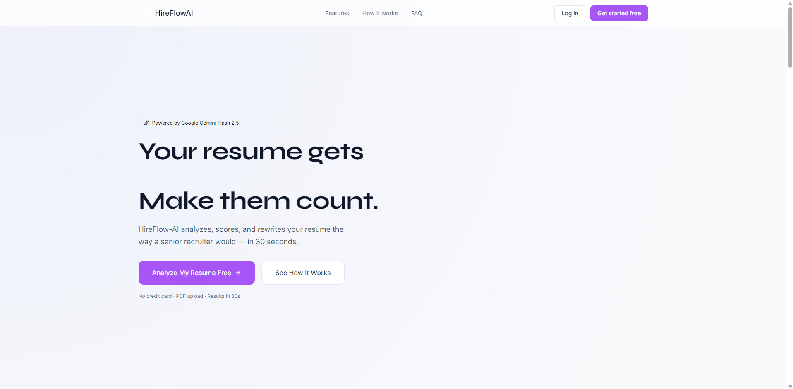
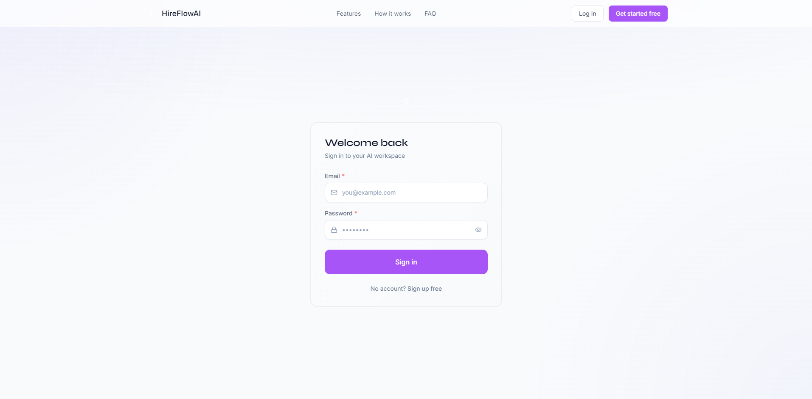
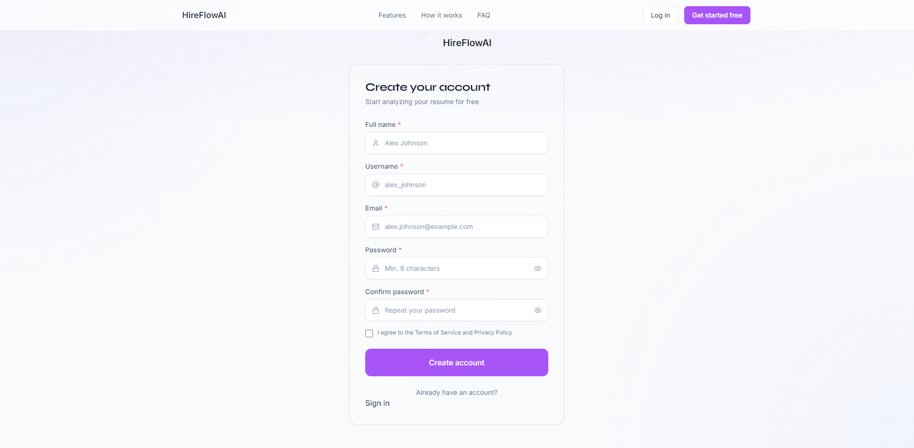
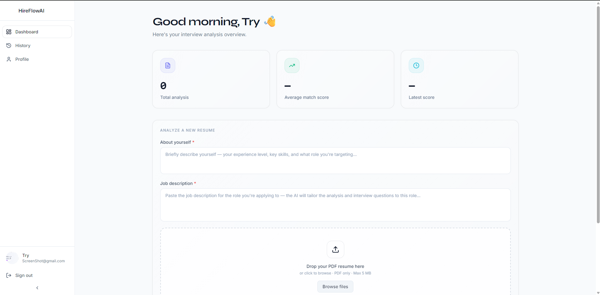
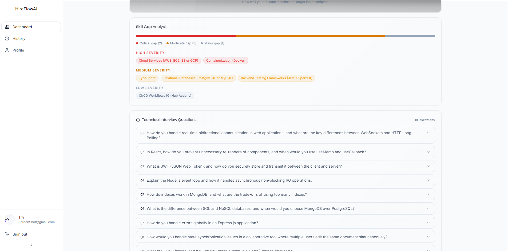
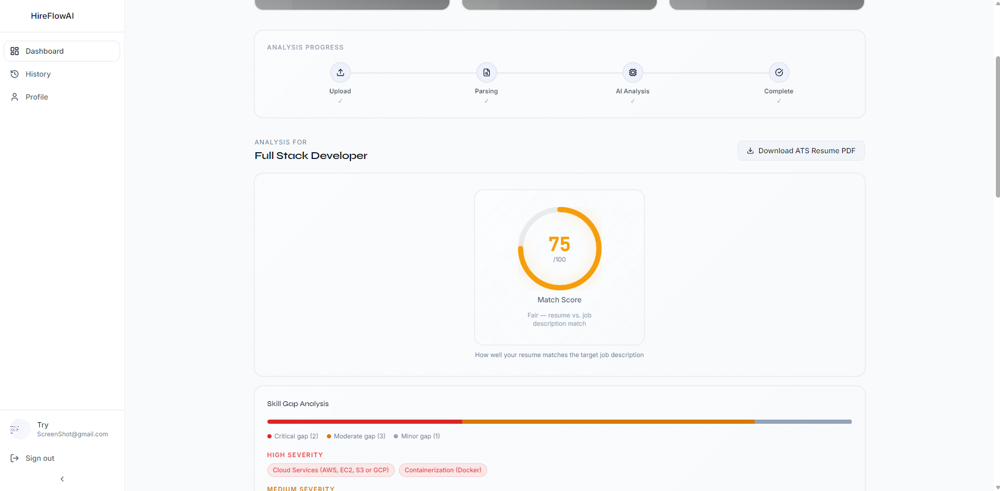
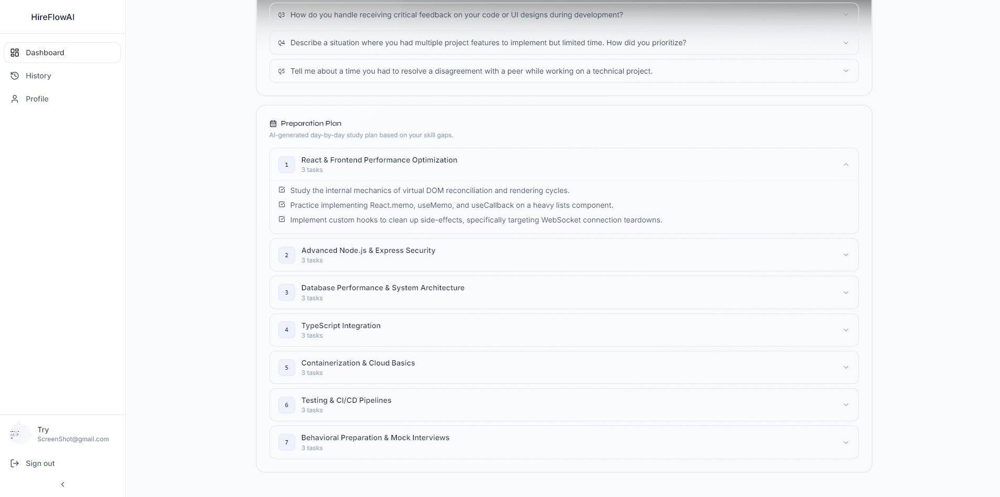
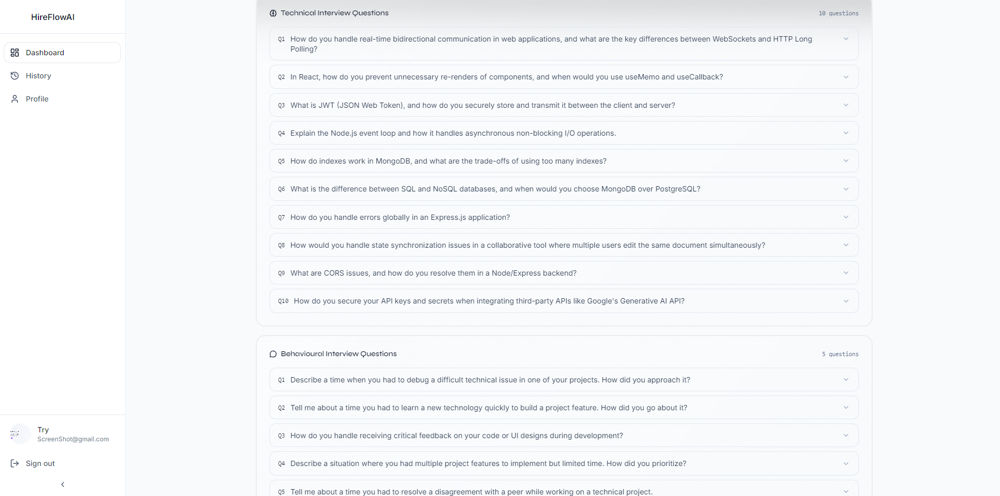
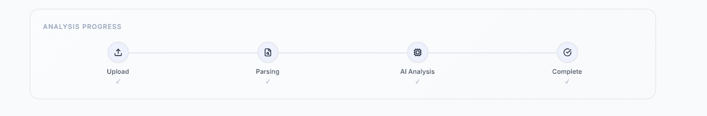
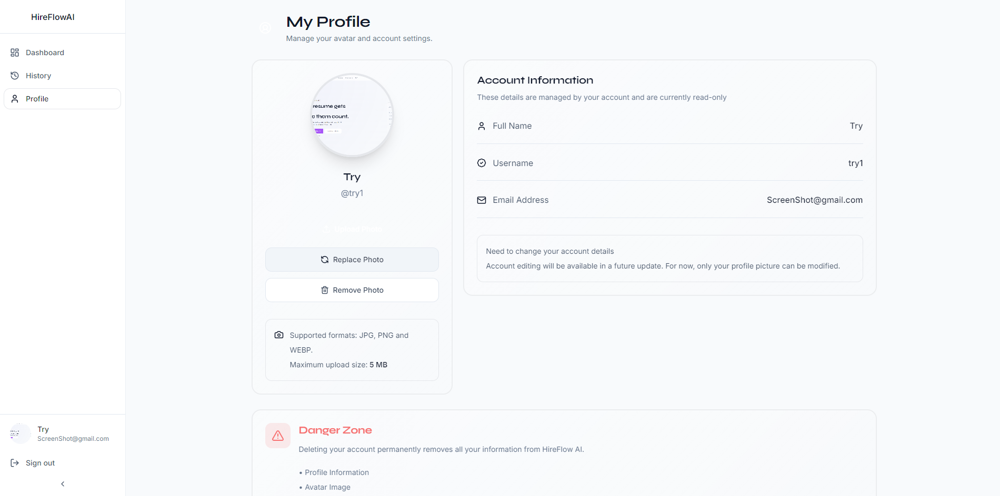

# 🚀 HireFlow AI – AI-Powered Resume Analysis & Interview Preparation Platform

HireFlow AI is a modern full-stack AI-powered career assistant built with the **MERN Stack** and **Google Gemini AI**.

It helps job seekers analyze their resumes against specific job descriptions, identify skill gaps, generate ATS-friendly resumes, prepare for interviews, and manage their professional profile—all from a single platform.

---

# ✨ Features

- 🤖 AI Resume Analysis using Google Gemini API
- 📄 ATS Resume Score & Optimization Suggestions
- 🎯 Job Description Matching
- 📊 Skill Gap Analysis
- 💡 Personalized Resume Improvement Recommendations
- 🎤 AI-Generated Technical & HR Interview Questions
- 📝 AI Resume Generator
- 📥 Download Resume as PDF
- 🔐 Secure JWT Authentication
- 👤 User Profile Management
- 🖼️ Avatar Upload with Cloudinary
- 🔄 Access & Refresh Token Authentication
- 📱 Fully Responsive UI
- ⚡ Fast & Modern React Interface
- 🌙 Beautiful Clean User Experience

---

# 🛠️ Tech Stack

## Frontend

- React.js
- Vite
- Tailwind CSS
- DaisyUI
- Redux Toolkit
- React Router DOM
- Axios
- React Hook Form
- Zod
- Framer Motion
- GSAP

## Backend

- Node.js
- Express.js
- MongoDB
- Mongoose
- JWT Authentication
- Multer
- Cloudinary
- Cookie Parser

## AI & External Services

- Google Gemini API
- Cloudinary

---

# 📂 Project Structure

```text
HireFlow-AI/
├── frontend/
│   ├── src/
│   ├── public/
│   └── package.json
│
├── backend/
│   ├── src/
│   │   ├── controllers/
│   │   ├── models/
│   │   ├── routes/
│   │   ├── middleware/
│   │   ├── utils/
│   │   └── db/
│   └── package.json
│
└── README.md
```

---

# 🚀 Core Workflow

1. Register or Login
2. Upload Resume
3. Paste Job Description
4. AI Resume Analysis
5. ATS Score Generation
6. Skill Gap Detection
7. AI Suggestions
8. Interview Question Generation
9. Resume Generation
10. Download PDF Resume

---

# 🔒 Security Features

- JWT Authentication
- Access Token & Refresh Token
- HTTP-only Cookies
- Password Hashing with bcrypt
- Protected API Routes
- Secure Cloudinary Uploads
- Input Validation

---

# 🌟 Future Enhancements

- Google OAuth
- GitHub OAuth
- Resume Version History
- AI Cover Letter Generator
- Job Tracker
- Saved Resume Reports
- Email Notifications
- Admin Dashboard
- Multi-language Support
- AI Career Chatbot

---

# 💻 Installation

## Clone Repository

```bash
git clone https://github.com/asiduki/HireFlow-AI.git
cd HireFlow-AI
```

## Install Backend

```bash
cd backend
npm install
```

## Install Frontend

```bash
cd frontend
npm install
```

---

# ⚙️ Environment Variables

Create a `.env` file inside the **backend** folder.

```env
PORT=5000

CLIENT_URL=http://localhost:5173

MONGODB_URL=your_mongodb_connection_string

JWT_SECRET=your_jwt_secret

ACCESS_TOKEN_SECRET=your_access_token_secret
REFRESH_TOKEN_SECRET=your_refresh_token_secret

CLOUDINARY_CLOUD_NAME=your_cloud_name
CLOUDINARY_API_KEY=your_cloudinary_api_key
CLOUDINARY_API_SECRET=your_cloudinary_api_secret

GEMINI_API_KEY=your_gemini_api_key
```

---

# ▶️ Run the Project

### Backend

```bash
cd backend
npx nodemon 
```

### Frontend

```bash
npm run dev
```

---

# 📸 Screenshots


- Landing Page

- Login / Register


- Dashboard

- Resume Analysis

- ATS Report

- AI Suggestions

- Interview Questions

- Resume Generator

- Profile Page


# ⭐ Support

If you found this project helpful, please consider giving it a ⭐ on GitHub.